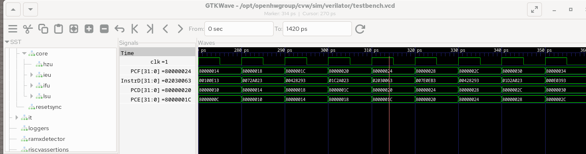
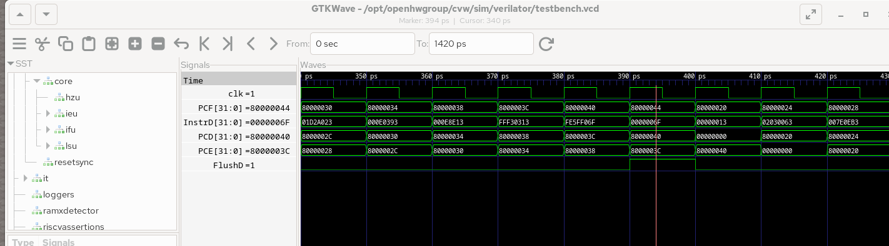
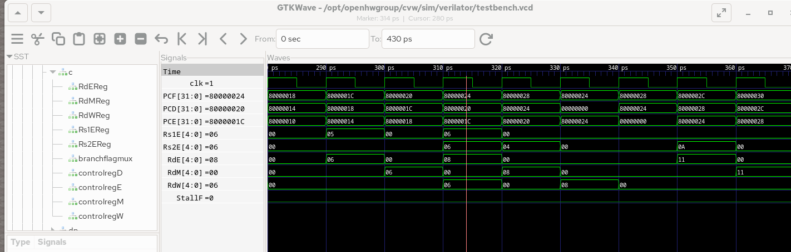
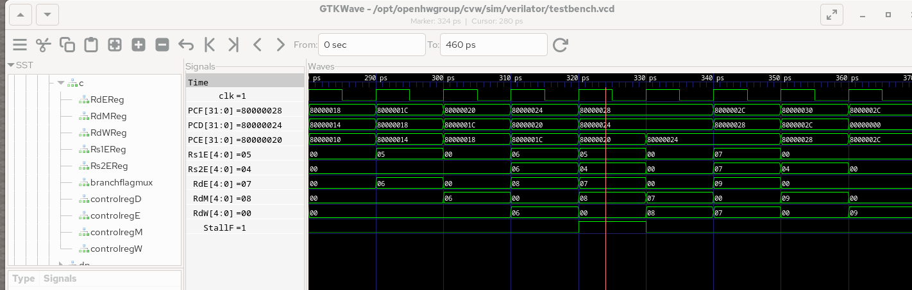

# RISC-V 5-Stage Pipeline & Hazard Analysis (RV32I)

[](LICENSE)
[](#pipeline-architecture--memory-layout)
[](#waveform-analysis)
[](#overview)

Cycle-by-cycle waveform analysis of a 5-stage pipelined **RISC-V (`rv32i`)** processor (**CORE-V Wally**) using **Verilator** and **GTKWave**. Developed as part of the **CMPE 344 (Computer Organization)** curriculum at **Boğaziçi University**.

---

## Table of Contents
- [Overview](#overview)
- [Key Objectives](#key-objectives)
- [Pipeline Architecture & Memory Layout](#pipeline-architecture--memory-layout)
- [Waveform Analysis](#waveform-analysis)
  - [Part I: 5-Stage Pipeline Progression (`add t2, t0, t1`)](#part-i-5-stage-pipeline-progression-add-t2-t0-t1)
  - [Part II: Control Hazard & Branch Flush (`blt t3, t4, L1`)](#part-ii-control-hazard--branch-flush-blt-t3-t4-l1)
  - [Part III: Data Hazard & Forwarding (`W -> E` Bypass)](#part-iii-data-hazard--forwarding-w---e-bypass)
  - [Part IV: Load-Use Hazard & Pipeline Stall](#part-iv-load-use-hazard--pipeline-stall)
- [Forwarding & Hazard Logic Summary](#forwarding--hazard-logic-summary)
- [Project Structure](#project-structure)
- [Prerequisites & Usage](#prerequisites--usage)
- [Full Technical Report](#full-technical-report)
- [License](#license)
- [Related Projects](#related-projects)

---

## Overview

Pipelined RISC-V processors overlap instruction execution across five stages: **Fetch (`F`)**, **Decode (`D`)**, **Execute (`E`)**, **Memory (`M`)**, and **Writeback (`W`)**. While pipelining increases instruction throughput, it introduces **control hazards** on taken branches and **read-after-write (RAW) data hazards** between dependent instructions.

This module inspects the cycle-by-cycle behavior of the **CORE-V Wally** (`rv32i`) processor simulated with **Verilator** (`testbench.vcd`). Using bare-metal RISC-V assembly testbenches and **GTKWave** signal traces, it examines normal pipeline progression, static branch-not-taken flushing, `W -> E` data forwarding, and single-cycle load-use stalls.

---

## Key Objectives

1. **5-Stage Pipeline Tracking**: Trace instruction progression across `PCF`, `PCD`, `PCE`, `PCM`, and `PCW` along with stage-pipelined control signals (`RegWrite`, `ResultSrc`, `MemWrite`, `ALUControlE`, `ALUSrcAE/BE`).
2. **Control Hazard Resolution**: Analyze static predict-not-taken branch handling in Execute (`PCSrcE = 1`) and the two-cycle flush of wrong-path instructions (`FlushD = 1`, `FlushE = 1`).
3. **Data Forwarding (`W -> E`)**: Verify zero-stall RAW hazard resolution (`ForwardAE = 2'b01`, `ForwardBE = 2'b01`) when a load and a dependent ALU instruction are separated by one instruction (`nop`).
4. **Load-Use Hazard & Pipeline Stall**: Write a bare-metal RV32I assembly testbench triggering a load-use hazard (`lw x7, 4(x5)` immediately followed by `add x9, x7, x7`), demonstrating front-end stalling (`StallF = 1`, `StallD = 1`) and `E`-stage bubble insertion (`FlushE = 1`).

---

## Pipeline Architecture & Memory Layout

The bare-metal testbenches are linked via `linker.ld` against the processor's physical memory map (`10 ps` clock period: rising edge at `4 ps`, falling edge at `9 ps` of each cycle):

| Region | Base Address | Section Types | Purpose |
| :--- | :--- | :--- | :--- |
| **ROM / Text** | `0x80000000` | `.text.init`, `.text`, `.htif` | Reset entry (`_start`), instruction stream, Host-Target Interface (`tohost`/`fromhost`) |
| **RAM / Data** | `0x80010000` | `.data`, `.sdata`, `.bss` | Word-aligned test array `arr: .word 1111, 2222, 3333, 4444, 5555, 6666` (`0x00000457`, `0x000008AE`, ...) |

---

## Waveform Analysis

### Part I: 5-Stage Pipeline Progression (`add t2, t0, t1`)

In `fibonacci.s`, the R-type instruction `add t2, t0, t1` (`0x006283B3` at `PC = 0x80000018`) computes `t2 = t0 + t1 = 0 + 1 = 1` across five consecutive clock cycles (`270 ps`–`320 ps`) without any hazards:

| Stage | Time Window | `PC` Signal (`0x80000018`) | Key Control & Datapath Signals |
| :--- | :--- | :--- | :--- |
| **Fetch (`F`)** | `270–280 ps` | `PCF = 0x80000018` | `InstrF = 0x006283B3` (`add t2, t0, t1`) |
| **Decode (`D`)** | `280–290 ps` | `PCD = 0x80000018` | `RegWriteD = 1`, `ResultSrcD = 0`, `MemWriteD = 0`, `RdD = 0x07` (`t2`) |
| **Execute (`E`)** | `290–300 ps` | `PCE = 0x80000018` | `ALUControlE = 0x0` (ADD), `ALUSrcAE = 0`, `ALUSrcBE = 0`, `IEUResultE = 0x1` |
| **Memory (`M`)** | `300–310 ps` | `PCM = 0x80000018` | `RegWriteM = 1`, `ResultSrcM = 0`, `IEUResultM = 0x00000001`, `RdM = 0x07` |
| **Writeback (`W`)** | `310–320 ps` | `PCW = 0x80000018` | `RegWriteW = 1`, `ResultSrcW = 0`, `ResultW = 0x00000001` written to `x7` (`t2`) |

<p align="center">
  
</p>

---

### Part II: Control Hazard & Branch Flush (`blt t3, t4, L1`)

CORE-V Wally employs a static **predict-not-taken** policy in `rv32i`. When `blt t3, t4, L1` (`0xFE6E4AE3` at `PC = 0x80000030`) evaluates as taken in Execute (`t3 < t4`), two sequential instructions (`0x80000034` and `0x80000038`) have already entered `D` and `F`:

- **Execute (`390–400 ps`, marker at `394 ps`):** The branch comparison asserts `JumpD = 0`, `BranchD = 1` (in Decode at `380–390 ps`) and `BranchE = 1`, `PCSrcE = 1` in Execute (`PCE = 0x80000030`).
- **Two-Stage Flush:** Asserting `PCSrcE = 1` drives `FlushD = 1` and `FlushE = 1` at `390–400 ps`. At the `400 ps` clock edge, both wrong-path instructions (`PCD = 0x80000034` and `PCF = 0x80000038`) are converted into `nop` bubbles (`0x00000013`, `PCW = 0x00000000`, `RegWrite = 0`, `MemWrite = 0`) while `PCF` redirects to the branch target `L1` (`0x80000014`).

<p align="center">
  
</p>

---

### Part III: Data Hazard & Forwarding (`W -> E` Bypass)

In the initial sequence (`lw x6, 0(x5)` -> `nop` -> `add x8, x6, x6`), the intervening `nop` separates the load (`0x80000014`) and dependent addition (`0x8000001C`) by one stage:

- At **`310–320 ps` (marker at `314 ps`)**, `lw x6, 0(x5)` reaches **Writeback (`PCW = 0x80000014`)** with `RegWriteW = 1`, `RdW = 0x06`, and `ResultW = 0x00000457` (`1111`), while `add x8, x6, x6` enters **Execute (`PCE = 0x8000001C`)** with `Rs1E = 0x06` and `Rs2E = 0x06`.
- Because `Rs1E == RdW` and `Rs2E == RdW`, the forwarding unit sets **`ForwardAE = 2'b01`** and **`ForwardBE = 2'b01`**, routing `ResultW = 0x00000457` directly into both ALU inputs (`IEUResultE = 0x000008AE = 2222`) with **zero stall cycles** (`StallF = 0`, `StallD = 0`, `FlushE = 0`).

<p align="center">
  
</p>

---

### Part IV: Load-Use Hazard & Pipeline Stall

In `src/hazard_analysis.s`, placing `lw x7, 4(x5)` (`0x0042A383` at `0x80000020`) immediately before `add x9, x7, x7` (`0x007384B3` at `0x80000024`) creates a **load-use hazard**:

| Cycle Window | `lw x7, 4(x5)` (`0x80000020`) | `add x9, x7, x7` (`0x80000024`) | Hazard & Forwarding Control Signals |
| :--- | :--- | :--- | :--- |
| **`320–330 ps` (`324 ps`)** | **Execute (`E`)**: `ResultSrcE[0] = 1`, `RdE = 0x07` | **Decode (`D`)**: `Rs1D = 0x07`, `Rs2D = 0x07` | **`StallF = 1`, `StallD = 1`, `FlushE = 1`** (Front-end stalled, bubble inserted into `E`) |
| **`330–340 ps`** | **Memory (`M`)**: `ReadDataM` fetched from data memory | **Decode (`D`)** *(held for 2nd cycle)* | `PCE = 0x00000000` (`InstrE = 0x00000013` bubble), `StallF = 0`, `StallD = 0`, `FlushE = 0` |
| **`340–350 ps`** | **Writeback (`W`)**: `ResultW = 0x000008AE` (`2222`) | **Execute (`E`)**: `Rs1E = 0x07`, `Rs2E = 0x07` | **`ForwardAE = 2'b01`, `ForwardBE = 2'b01`** (`ResultW` forwarded -> `IEUResultE = 0x0000115C = 4444`) |

<p align="center">
  
</p>

---

## Forwarding & Hazard Logic Summary

| Mechanism | Trigger Condition in CORE-V Wally | Hardware Action | Penalty |
| :--- | :--- | :--- | :--- |
| **`M -> E` Bypass** | `(Rs1E/Rs2E == RdM) && (Rs1E/Rs2E != 0) && RegWriteM` | `ForwardAE / ForwardBE = 2'b10` (routes `IEUResultM`) | `0` cycles |
| **`W -> E` Bypass** | `(Rs1E/Rs2E == RdW) && (Rs1E/Rs2E != 0) && RegWriteW` *(no `M` match)* | `ForwardAE / ForwardBE = 2'b01` (routes `ResultW`) | `0` cycles |
| **Load-Use Interlock** | `ResultSrcE[0] == 1 && ((Rs1D == RdE) \|\| (Rs2D == RdE)) && (RdE != 0)` | `StallF = 1`, `StallD = 1`, `FlushE = 1`, followed by `W -> E` bypass | `1` cycle |
| **Taken Branch Flush** | `PCSrcE == 1` (`(BranchE && Flags) \|\| JumpE`) | `FlushD = 1`, `FlushE = 1`, redirects `PCF` to `PCTargetE` | `2` cycles |

---

## Project Structure

```text
05-riscv-pipeline-hazard-analysis/
├── Makefile                       # Build, disassembly, Verilator simulation & LaTeX automation
├── LICENSE                        # MIT License
├── README.md                      # Microarchitectural documentation and waveform analysis
├── linker.ld                      # Bare-metal RV32I linker script (0x80000000 .text, 0x80010000 .data)
├── config/
│   └── signals.gtkw               # GTKWave signal hierarchy configuration
├── src/
│   └── hazard_analysis.s          # Bare-metal RV32I RAW & load-use hazard verification testbench
├── assets/
│   ├── part1_wave.png             # Part I: 5-stage pipeline progression (314 ps)
│   ├── part2_wave.png             # Part II: Taken branch recovery & FlushD/FlushE (394 ps)
│   ├── part3_wave.png             # Part III: W-to-E RAW data forwarding (314 ps)
│   └── part4_wave.png             # Part IV: Load-use StallF/StallD & FlushE interlock (324 ps)
└── report/
    ├── report.pdf                 # Compiled 4-page technical verification report
    └── report.tex                 # Full LaTeX source
```

---

## Prerequisites & Usage

### 1. Prerequisites

- **Docker** with the `ghcr.io/bouncmpe/labs344:latest` image (includes `riscv64-unknown-elf-gcc`, CORE-V Wally RTL, Verilator, and GTKWave), *or* a local installation of the RISC-V GNU Toolchain and OpenHW Group CORE-V Wally.
- **LaTeX (`pdflatex`)** (*Optional*, for compiling `report/report.tex`).

### 2. Assemble, Link & Simulate via Docker

```bash
# Assemble RV32I ELF and generate disassembly
make docker-build

# Run Verilator RTL simulation on CORE-V Wally (generates testbench.vcd)
make docker-sim
```

### 3. Run Directly Inside the Lab Container

```bash
make all
make simulate
gtkwave /opt/openhwgroup/cvw/sim/verilator/testbench.vcd config/signals.gtkw
```

### 4. Compile the LaTeX Technical Report

```bash
make build-report
```

---

## Full Technical Report

The complete 4-page technical report detailing cycle-by-cycle signal transitions, memory disassemblies, forwarding multiplexers, and hazard interlocks is available at [report/report.pdf](report/report.pdf).

---

## License

This project is licensed under the **MIT License**. See the [LICENSE](LICENSE) file for details.

---

## Related Projects

- **[Solar-Escape-RISCV-Navigator](../02-bare-metal-riscv-simulator)**: Bare-metal RISC-V (RV32I) assembly simulation for fuel-constrained westward autonomous navigation on Spike.
- **[CoreMark-Performance-Profiling](../04-coremark-performance-profiling)**: Empirical EEMBC CoreMark v1.0 compiler optimization and RISC-V ISA extension benchmarking suite.
- **[SchedSim-CPU-Scheduler](../01-x86-64-cpu-scheduler)**: Zero-libc CPU scheduling simulator written in pure x86-64 GNU Assembly using direct Linux kernel syscalls.
- **[Unix-Command-Interpreter](../03-unix-command-interpreter)**: Modular C11 Unix shell featuring a recursive descent parser and grammar backtracking.

---

*Developed by Yiğit Sarp Avcı*
